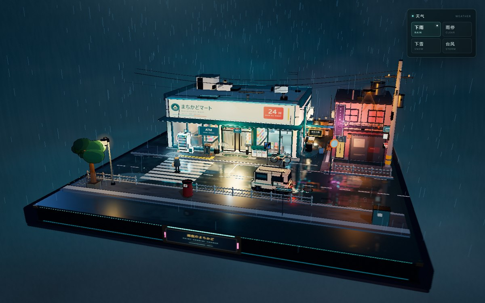
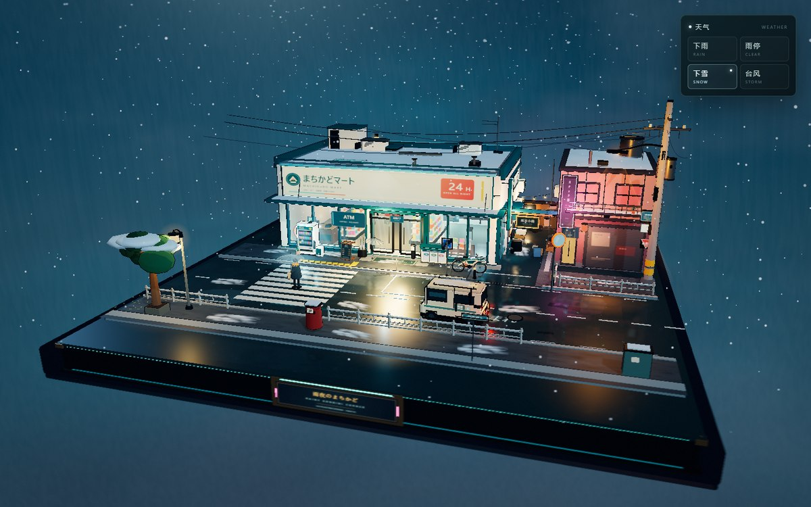

# 雨夜便利店 · 街角微缩模型

一个无需构建工具或后端的 Three.js 实时三维场景。默认打开的是「雨夜便利店」——一处除右上角小型天气控制台外没有其他界面遮罩、可以直接拖拽旋转和缩放的雨夜街角微缩景观。此前的「熔火王座 / 赤境之门」双场景幻想世界仍然保留。

在线预览：[雨夜便利店街角微缩模型](https://tianxiuyangyang.github.io/molten-realm/)



## 运行

在项目根目录启动任意静态文件服务：

```powershell
python -m http.server 4173 --bind 127.0.0.1
```

然后打开 [http://localhost:4173/](http://localhost:4173/)。也可以双击 `start-preview.bat`，它会启动本地服务并打开默认场景。不要直接双击 `index.html`，浏览器会阻止 `file:///` 页面加载 ES modules。

## 雨夜便利店

- 打开后除右上角天气控制台外没有其他 HUD、标题或操作提示，主体始终是完整的微缩模型。
- 鼠标左键拖动环绕、滚轮缩放、右键拖动平移；触屏单指环绕、双指缩放与平移。相机始终保持在参考观察模式。
- 场景固定在一块完整的正方形收藏底板上：便利店、街角道路、侧巷与对街人行道都搭建在底座范围内。
- 与旧场景一致，右键拖动可以在画面内平移观察位置；平移、环绕与缩放互不冲突。
- 外部包含便利店发光招牌、玻璃橱窗、自动门、雨棚、地垫、自动贩卖机、自行车、雨伞架、分类垃圾桶、路灯、电线杆与电线、路牌、街角护栏、停车位、排水沟、积水路面、反光斑马线、小巷入口、屋顶与侧墙空调外机、公告栏等。
- 场景还包含雨夜的湿润反光、斑马线倒影、路面水洼、雨滴涟漪、霓虹光晕、店内的暖色货架与冷柜，以及一位撑透明伞过街的小小行人。
- 风格采用三渲二思路：MeshToon 材质分级明暗、深色轮廓壳、发光招牌与 Bloom、冷蓝夜色与便利店暖光/酒吧霓虹的对比。

## 天气控制台

右上角控制台只出现在雨夜便利店场景中，默认选中「下雨」，切换后天气与场景光照会平滑过渡。

- **下雨**：初始默认状态，与原场景一致；雨丝、地面涟漪、霓虹积水和湿地面反射持续工作。
- **雨停**：雨丝与雨滴涟漪淡出，湿地面反光减弱，夜色变得更清透。
- **下雪**：换成飘雪粒子，屋顶、雨棚、树冠、人行道与车辆顶部逐渐积雪，环境光转为更亮更冷的雪夜色调。
- **台风**：雨势加密并明显倾斜，加入被风卷起的碎叶纸屑、更暗的天空、更浓的雾和偶发的闪电。



实现文件：

- `src/konbini-world.js`：场景装配、灯光、镜头与整体更新。
- `src/konbini-store.js`：便利店内外、招牌、玻璃、门头、屋顶与侧墙。
- `src/konbini-street.js`：正方形展台、道路、人行道、斑马线、停车位、护栏、路灯、电线、树木与路牌。
- `src/konbini-props.js`：自动贩卖机、自行车、垃圾桶、伞架、行人、送货车、酒吧与小巷。
- `src/konbini-atmosphere.js`：雨、雪、涟漪、台风碎屑、夜间天空、雾、湿地面平面反射与天气过渡。
- `src/konbini-materials.js`、`src/konbini-textures.js`、`src/konbini-utils.js`：程序化材质、招牌/海报纹理和几何辅助。
- `src/main.js`：场景切换、观察控制、画质渲染管线。

便利店场景在 `src/main.js` 中标记为 `clean:true`：进入该区域时会隐藏旧场景的通用界面，只保留右上角天气控制台，并保持完整的参考观察操作——环绕、缩放与右键平移；没有“进入场景”按钮、Pointer Lock 或第一人称飞行。

## 旧场景

原有的熔火世界仍可通过 URL 直接打开，并保留原来的界面：

- [http://localhost:4173/?region=portal](http://localhost:4173/?region=portal)（赤境之门）
- [http://localhost:4173/?region=citadel](http://localhost:4173/?region=citadel)（熔火王座）

旧场景的界面里新增了第三个区域按钮；点击后会载入雨夜便利店并自动隐藏界面。

`scene-manifest.json` 记录各区域的坐标、相机、材质、灯光和构图假设。画布中的空间全部由实时几何、程序化纹理和灯光生成。

## 已验证

- 桌面 1440 × 900 与移动端 390 × 844 实际渲染截图；天气控制台在移动端仍完整位于视口内。
- 下雨、雨停、下雪、台风四种状态均可切换并恢复默认下雨；按钮状态、场景光照和粒子均同步更新。
- 鼠标拖动环绕、滚轮缩放、右键拖动平移；相机不会进入第一人称。
- 旧场景 `?region=portal`、`?region=citadel` 及三区域切换保持原有界面和渲染，天气控制台在旧场景中自动隐藏。
- `src/konbini-*.js` 模块语法检查通过，浏览器控制台无报错或警告。
- 湿地面反射、雨滴、霓虹 Bloom 与静态阴影贴图在同一渲染循环中工作。

## GitHub Pages

项目使用仓库 `main` 分支根目录发布，`.nojekyll` 保证本地 ES 模块与资源原样部署。页面资源使用相对路径，兼容 GitHub Pages 仓库子路径。

Three.js 及附加模块的 MIT 许可证见 `libs/LICENSE`；其他说明见 `THIRD_PARTY_NOTICES.md`。
